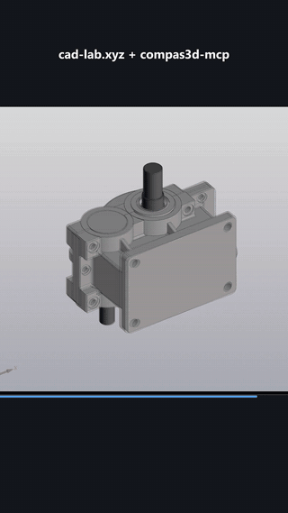
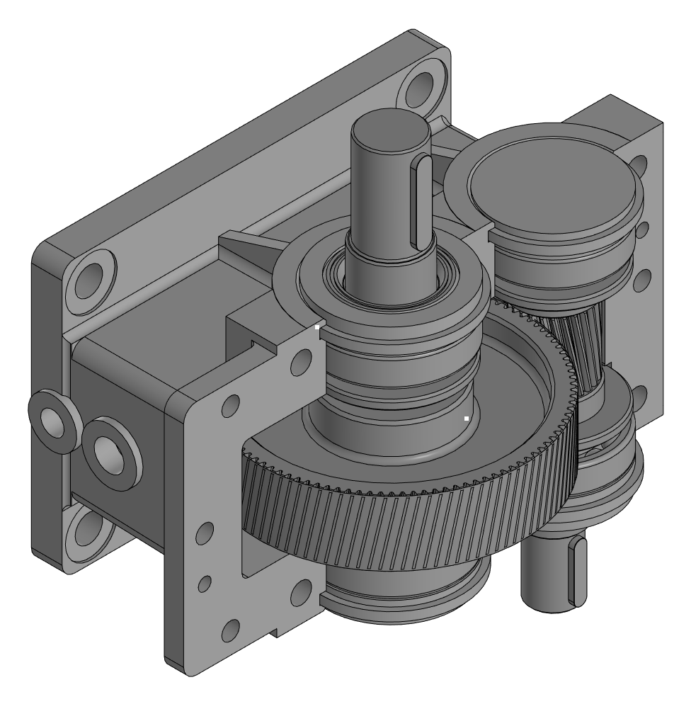
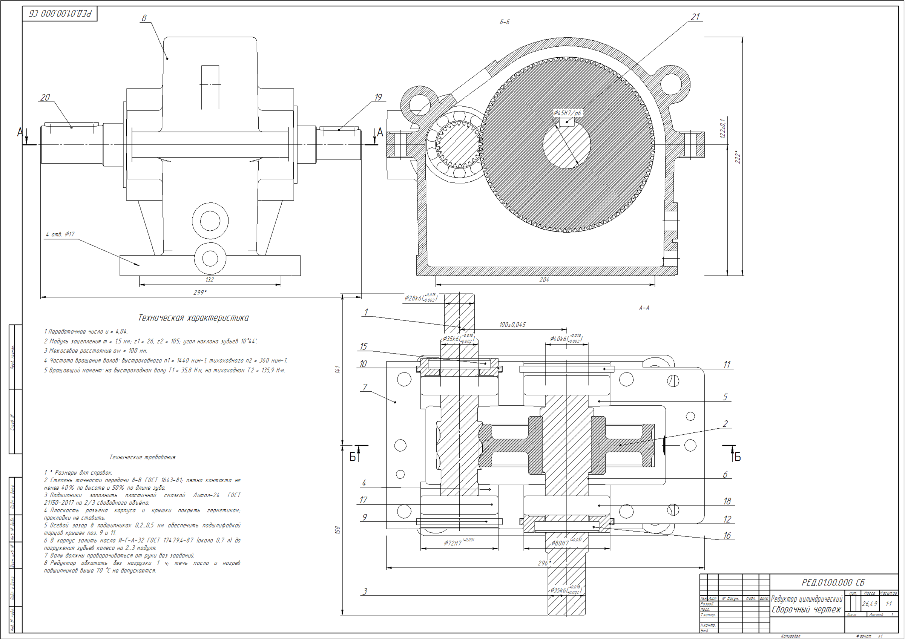
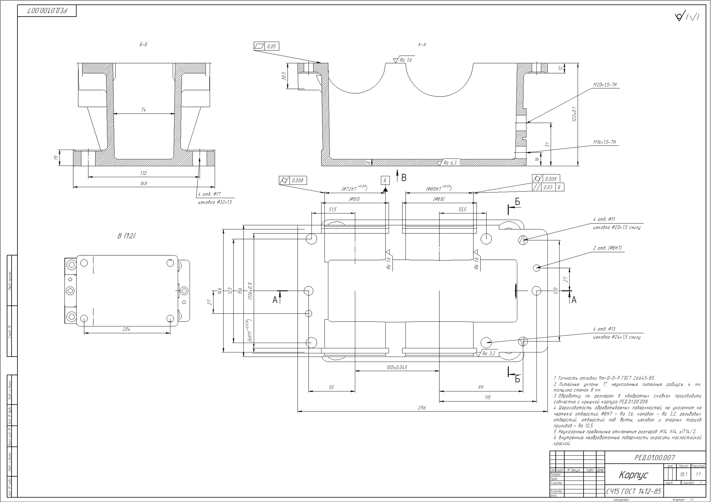
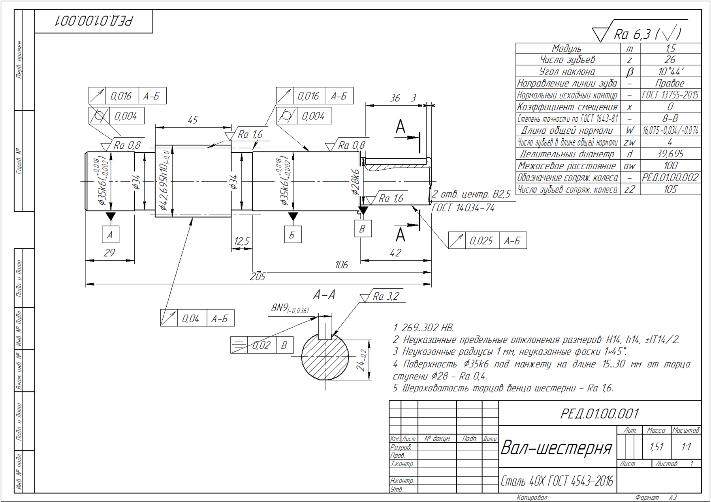
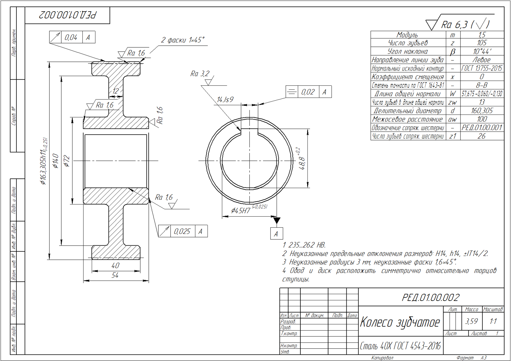

# КОМПАС-3D: агент в вашей модели

MCP-сервер для КОМПАС-3D. Подключает Claude, Codex, Cursor и любого другого агента с поддержкой MCP к
**открытому у вас КОМПАС**: агент строит и правит детали и сборки, читает чертежи и спецификации, проверяет
зазоры, делает разрезы и снимки вида и отчитывается цифрами.

Агент не генерирует файлы с нуля — он работает в вашей модели и вашей сборке, в привычном окне КОМПАС, и
модель остаётся редактируемой: дерево построения, эскизы, переменные, сопряжения.

**[Скачать последнюю версию](https://github.com/cad-lab-ai/kompas-mcp/releases/latest)** · бесплатно для некоммерческого использования ·
сайт [cad-lab.xyz](https://cad-lab.xyz)

> **Об исходниках.** Первые недели публикуем только сборку — смотрим, насколько коннектор нужен людям.
> Исходники выложим следом. Если хотите участвовать в разработке — напишите
> [в issue «Хочу участвовать»](https://github.com/cad-lab-ai/kompas-mcp/issues/new?template=contribute.yml):
> позовём, как только откроем код.

## Как это выглядит

Одноступенчатый цилиндрический редуктор, который агент спроектировал в КОМПАС за одну беседу: расчёт передачи,
сборка, валы и колесо, литой корпус и крышка, крышки подшипников, полный комплект конструкторской документации.
Подшипники, шпонки и манжеты — из библиотек КОМПАС. В ролике то же построение повторено мелкими шагами, чтобы
каждый шаг было видно.

<table>
  <tr>
    <td width="34%" align="center">
      <a href="https://github.com/cad-lab-ai/kompas-mcp/raw/main/media/reducer.mp4"></a><br>
      <a href="https://github.com/cad-lab-ai/kompas-mcp/raw/main/media/reducer.mp4">▶ Ролик целиком: 1 мин, mp4 9 МБ</a>
    </td>
    <td width="66%" align="center">
      <br>
      Сборка без крышки корпуса
    </td>
  </tr>
</table>

<table>
  <tr>
    <td width="50%" align="center">
      <a href="media/drawing-assembly.png"></a><br>
      Сборочный чертёж, А1
    </td>
    <td width="50%" align="center">
      <a href="media/drawing-housing.png"></a><br>
      Корпус, литьё, А1
    </td>
  </tr>
  <tr>
    <td width="50%" align="center">
      <a href="media/drawing-pinion-shaft.png"></a><br>
      Вал-шестерня с таблицей параметров, А3
    </td>
    <td width="50%" align="center">
      <a href="media/drawing-gear.png"></a><br>
      Колесо зубчатое, А3
    </td>
  </tr>
</table>

## Что можно попросить

- «Сделай фланец Ø120 с шестью отверстиями под M8 на Ø95»
- «Покажи, из чего состоит сборка, и что зависит от эскиза основания»
- «Увеличь межосевое расстояние до 125 и посмотри, что сломается»
- «Проверь зазор между крышкой и корпусом»
- «Сделай разрез по оси X и покажи размеры»
- «Проверь чертёж: пустые графы штампа, размеры без допусков»
- «Выгрузи сборку в STEP»
- «Откати последний шаг»

## Как агент обращается с моделью

- **Правит только этапами.** Этап — одна запись в отмене КОМПАС: всё, что агент сделал за шаг, снимается одним
  Ctrl+Z.
- **Проверяет, прежде чем отчитаться.** Закрывая этап, агент получает отчёт: перестроение без ошибок,
  пересечения тел, ваши условия («зазор ≥ 2 мм», «масса ≤ 1,2 кг») — и называет результат числами.
- **Не мешает вам.** Если вы начнёте править модель, пока у агента открыт этап, этап закроется принудительно —
  ваши правки не смешаются с его. Агент может работать и в отдельном окне КОМПАС, не трогая ваше.
- **Видит то, что показываете вы.** Выделите грань или деталь и добавьте в корзину агента — он поймёт, о чём речь.
- **Сначала спрашивает уровень проработки** новой детали: эскизная компоновка или рабочая модель с фасками и
  допусками.

## Что нужно

- Windows 10/11 x64
- КОМПАС-3D v19 (x64). Поддержка более новых версий — в работе.
- .NET Framework 4.8 (в Windows 10/11 обычно уже есть)
- Агент с поддержкой MCP: Claude Code, Claude Desktop, Codex, Cursor, VS Code (Copilot), Gemini CLI, Windsurf,
  LM Studio или другой

Права администратора и системный Python не нужны: всё ставится в профиль пользователя, Python встроен в
поставку.

## Установка

1. Скачайте `KompasAgent-<версия>.zip` со [страницы релизов](https://github.com/cad-lab-ai/kompas-mcp/releases/latest),
   распакуйте и запустите в папке установщик:

   ```bash
   powershell -ExecutionPolicy Bypass -File install.ps1
   ```

   Установщик копирует поставку в `%LOCALAPPDATA%\Programs\KompasAgent`, подключает библиотеку в КОМПАС,
   регистрирует MCP-сервер `kompas` во всех найденных на машине агентах (их остальные настройки не трогает) и
   кладёт им навык `kompas-engineering`. Повторный запуск безопасен — так же ставится и обновление.

2. В КОМПАС: меню библиотеки **«Агент КОМПАС (MCP)» → «Запустить агента»** (в каждой сессии КОМПАС).
   Если КОМПАС не был запущен при установке — после запуска выполните `install.ps1 -AttachOnly` или подключите
   библиотеку `KompasAgent.Library` в Менеджере библиотек (вкладка ActiveX).

3. Перезапустите агента (Claude, Codex…) и попросите его проверить связь — он вызовет `kompas_health`.

### Какие агенты настраиваются сами

| id | агент | куда пишется сервер | навык |
|---|---|---|---|
| `claude-code` | Claude Code | `claude mcp add --scope user` (если `claude` в PATH) | `~\.claude\skills` |
| `claude-desktop` | Claude Desktop | `%APPDATA%\Claude\claude_desktop_config.json` | `~\.claude\skills` (вкладка Code) |
| `cursor` | Cursor | `~\.cursor\mcp.json` | `~\.claude\skills` или `~\.agents\skills` |
| `vscode` | VS Code (Copilot) | `%APPDATA%\Code\User\mcp.json` | `~\.claude\skills` или `~\.agents\skills` |
| `codex` | Codex | `~\.codex\config.toml` | `~\.agents\skills` |
| `gemini` | Gemini CLI | `~\.gemini\settings.json` | `~\.agents\skills` |
| `windsurf` | Windsurf / Devin Desktop | `%APPDATA%\devin\mcp_config.json` | — |
| `lmstudio` | LM Studio | `~\.lmstudio\mcp.json` | — |

Агент считается найденным, если на машине есть папка его настроек. Codex и Gemini CLI получают увеличенный
таймаут вызова: долгая правка модели может идти дольше их стандартных 60 с и 10 мин.

**Другой агент.** Пропишите MCP-сервер вручную (stdio):

```json
{
  "mcpServers": {
    "kompas": {
      "command": "%LOCALAPPDATA%\\Programs\\KompasAgent\\python\\python.exe",
      "args": ["-m", "kompas_mcp"]
    }
  }
}
```

`%LOCALAPPDATA%` замените полным путём, если агент не раскрывает переменные окружения. Навык лежит в
`skill\kompas-engineering` архива — положите его в папку навыков агента или подключите как системный промпт.

### Параметры установщика

| параметр | что делает |
|---|---|
| `-Prefix <папка>` | куда ставить (по умолчанию `%LOCALAPPDATA%\Programs\KompasAgent`) |
| `-McpConfig auto\|none\|<id>,<id>…` | каким агентам прописать сервер: всем найденным, никому или перечисленным |
| `-NoSkill` | не класть навык `kompas-engineering` |
| `-NoAttach` | не подключать библиотеку в запущенном КОМПАС |
| `-AttachOnly` | только подключить библиотеку в запущенном КОМПАС |
| `-Feedback on\|off` | инструмент отзывов разработчикам (ниже) |
| `-Uninstall` | удалить: убирает ровно то, что записал установщик |

## Инструменты

| группа | инструменты |
|---|---|
| обзор и поиск | `project_overview`, `model_overview`, `find`, `inspect`, `impact`, `where_used`, `variables`, `drawing_read`, `query` |
| правка этапами | `change_begin` → `code_exec` → `change_end`; `change_abort`, `change_undo`, `change_status`, `history`, `test_exec` (проба с автооткатом), `code_scan`, `api_doc` |
| проверки | `validate`, `assert_register` / `assert_list` / `assert_enable` / `assert_disable` / `assert_remove` |
| вид и человек | `view_capture`, `view_state`, `basket_get`, `selection_get`, `gui_show`, `gui_preview`, `show_stage_changes`, `dialog` |
| документы | `document_open`, `document_new`, `document_info`, `document_activate`, `document_save`, `document_save_as`, `document_close`, `session_recover` |
| экспорт | `export_shape` (STEP, IGES, STL…), `export_section` (сечения и разрезы), `export_drawing` (PDF, DXF, PNG) |
| библиотеки КОМПАС | `extensions_list`, `extension_exec` |
| свой КОМПАС агента | `instance_start`, `instance_list`, `instance_attach`, `instance_stop` |
| служебные | `kompas_health`, `system_info`, `tool_contract`, `log_tail`, `feedback` |

Порядок работы агента — в навыке [`skill/kompas-engineering`](skill/kompas-engineering/SKILL.md): требование в
числах, разведка по модели, проба, правка этапом, проверка. Навык ставится вместе с сервером.

## Безопасность и данные

- Сервер работает только на вашей машине. Связь агента с КОМПАС — локальная, через `127.0.0.1` с токеном сессии.
- Модель, документы и кадры никуда не отправляются: их видит только ваш агент (и, значит, провайдер модели,
  которой вы пользуетесь).
- **Отзывы разработчикам** — инструмент `feedback`. Агент предлагает отправить отзыв, когда инструмент повёл себя
  не по описанию или задача далась слишком тяжело, и отправляет **только с вашего согласия в чате**. Уходят суть
  отзыва (пути, имена файлов и почта вычищаются), версии коннектора, КОМПАС и ОС, имя агента и имена последних
  вызванных инструментов с кодами ошибок — без параметров. Адрес — `https://feedback.cad-lab.xyz`. Выключить
  совсем: `install.ps1 -Feedback off` или переменная окружения `KOMPAS_FEEDBACK=0` у MCP-сервера.

## Если что-то не работает

- Агент не видит инструментов `kompas` — перезапустите агента после установки; проверьте, что сервер прописан
  (`claude mcp list`, `~\.codex\config.toml` и т.п.).
- `kompas_health` отвечает, что КОМПАС недоступен — в КОМПАС не запущен агент: меню библиотеки «Агент КОМПАС
  (MCP)» → «Запустить агента».
- Каталог инструментов без агента:
  `"%LOCALAPPDATA%\Programs\KompasAgent\python\python.exe" -m kompas_mcp --list`.
- Остальное — [issue](https://github.com/cad-lab-ai/kompas-mcp/issues/new/choose) с версией коннектора и КОМПАС
  и последними строками журнала (агент достанет их инструментом `log_tail`).

## Лицензия

Бесплатно для личного, учебного и некоммерческого использования. Коммерческое использование запрещено без
отдельного разрешения. Распространяется как есть, без гарантий. Подробно — [LICENSE](LICENSE).
КОМПАС-3D — продукт и товарный знак АСКОН; коннектор не связан с АСКОН.
